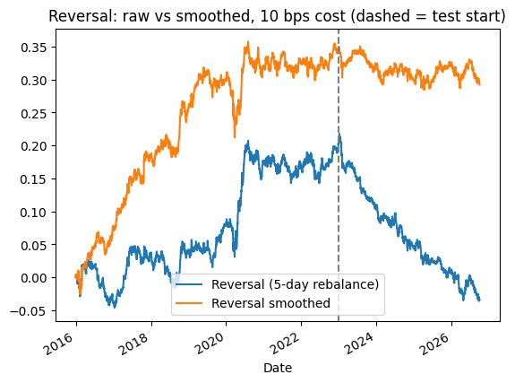
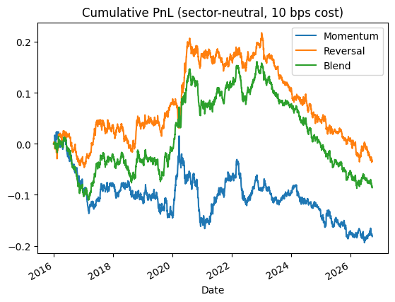
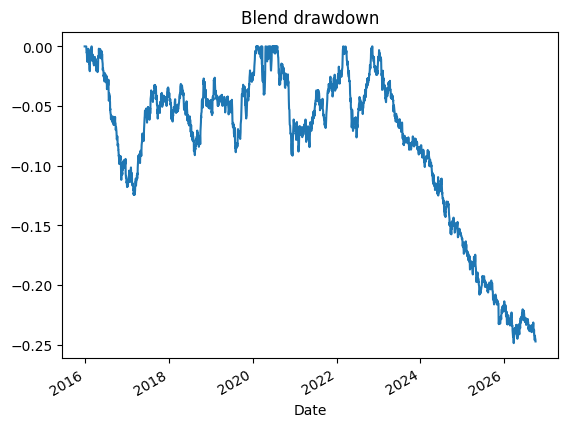

# Short-Term Reversal & Momentum on NSE Large Caps

## Question
Do past price moves predict which Indian large-cap stocks outperform others,
and does the edge survive transaction costs and out-of-sample testing?

## Setup
- Universe: 45 Nifty large caps, daily adjusted prices, 2016–2026 (Yahoo Finance)
- Signals: 12-1 month momentum, 5-day reversal
- Cross-sectional rank → sector-neutralized → dollar-neutral long-short, gross exposure 1
- Next-day execution (no look-ahead), 10 bps cost per unit turnover
- Train 2016–2022, test 2023–2026; smoothing span chosen on train data only

## Results (full period 2016–2026)
| Strategy | Gross Sharpe | Net Sharpe (10 bps) | Turnover / day |
|---|---|---|---|
| Momentum (sector-neutral) | -0.22 | -0.33 | 0.023 |
| Reversal (sector-neutral, 5-day rebalance) | 1.37 | -0.06 | 0.283 |
| Reversal smoothed (EWM span 20) | **1.57** | **0.53** | **0.216** |

- Momentum: no edge in Indian large caps over this period.
- Reversal: real signal (mean daily IC 0.037, IC IR 0.22), but the raw version breaks even at only ~10 bps.
- EWM smoothing (span picked from 5 / 10 / 20 on train data) improved the signal and cut turnover by 24%.

### Cost sensitivity
| Cost (bps) | Raw reversal Sharpe | Smoothed reversal Sharpe |
|---|---|---|
| 0 | 1.37 | 1.57 |
| 5 | 0.65 | 1.05 |
| 10 | -0.06 | 0.53 |
| 20 | -1.42 | -0.51 |

## Out-of-sample (smoothed reversal)
| | Train 2016–22 | Test 2023–26 |
|---|---|---|
| Gross Sharpe | 1.85 | 0.89 |
| Net Sharpe (10 bps) | 0.89 | -0.37 |

The signal still predicts returns in the test period (gross Sharpe 0.89), but the edge
has shrunk. Yearly mean IC fell from ~0.035 (2016–17) to ~0.01–0.02 (2023–25), so the
edge is now smaller than realistic trading costs: classic alpha decay.

## Charts

### Raw vs smoothed reversal (10 bps cost, dashed line = test start)

### Cumulative PnL: momentum, reversal and blend (10 bps cost)

### Blend drawdown

## Limitations
- Survivorship bias: universe = current index members
- Small universe (45 stocks) gives noisy ranks
- Weights are not drifted between rebalances
- Shorting in India needs stock futures or SLB, which adds cost

## Next steps
- Larger universe (Nifty 500) with historical constituents
- Cost-aware rebalancing (trade only when the rank change is large)
- Volatility scaling
- India-specific signals such as NSE delivery percentage
